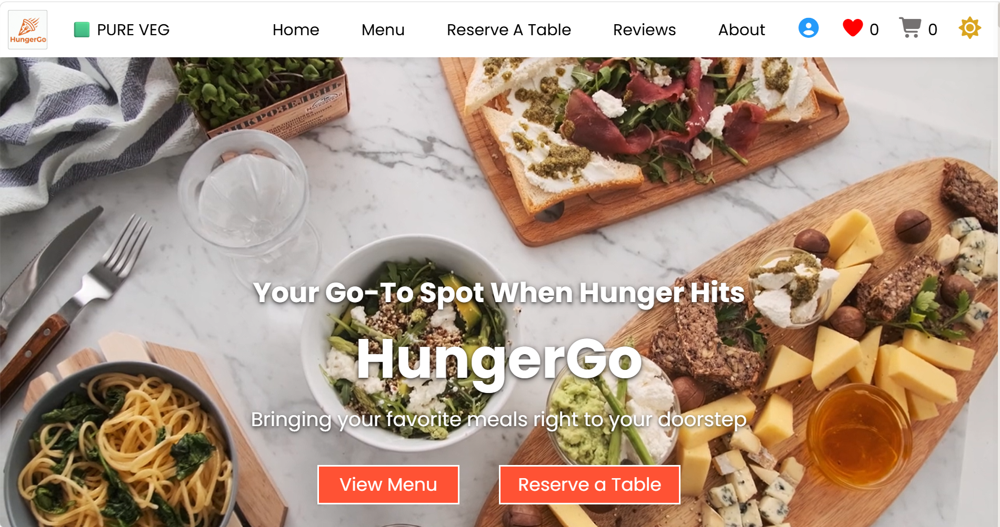
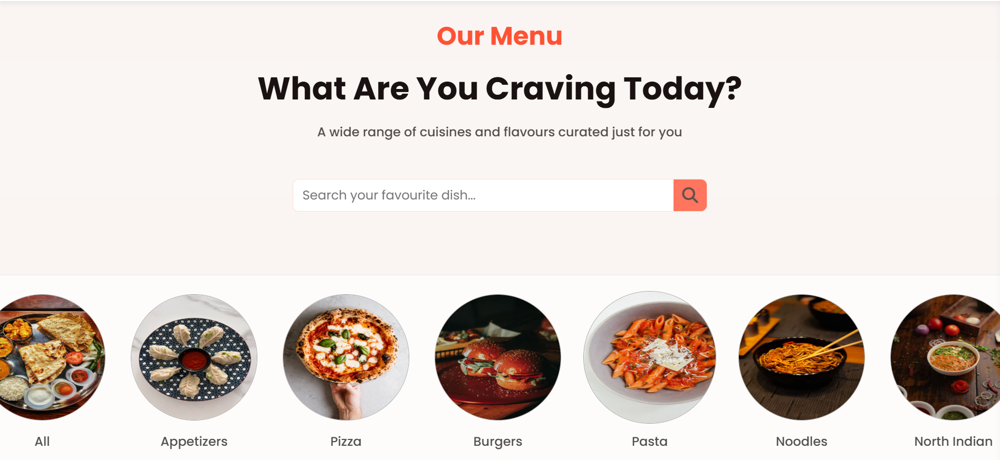
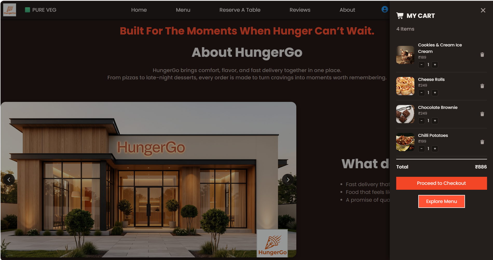
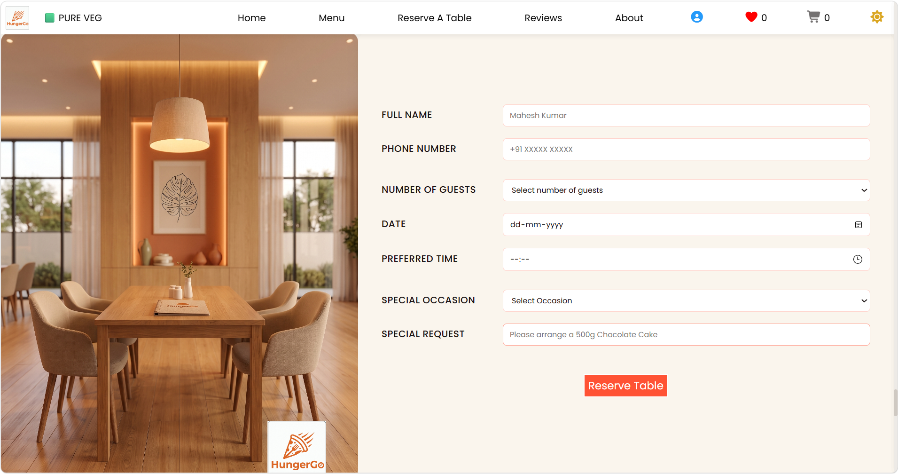

# HungerGo

**Your Go-To Spot When Hunger Hits**

HungerGo is a modern, responsive restaurant website that delivers a premium digital dining experience through an elegant user interface and seamless interactions. Built using **HTML**, **CSS**, and **Vanilla JavaScript**, the project features dynamic menu browsing, intelligent search, interactive filtering, table reservations, wishlist and cart management, customer reviews, and a visually rich restaurant showcase.

---

## Features

### Hero Section

* Full-width autoplay background video
* Engaging call-to-action buttons for menu browsing and table reservations
* Smooth scrolling navigation

### Dynamic Menu

* Menu generated dynamically from a structured JavaScript data array
* Multiple cuisine categories with an **All** view
* Interactive category browsing
* Responsive food card layout

### Smart Search

* Real-time search suggestions
* Instant dish lookup
* Smart navigation to matching food cards
* Automatic category switching based on search results

### Advanced Filters

* Filter dishes by rating
* Filter by price range
* Best Seller filtering
* Category-aware filtering for accurate results

### Wishlist & Cart

* Add and remove dishes from Wishlist
* Shopping Cart management
* Live item counters in the navigation bar

### Theme Toggle

* Light/Dark mode switching
* Smooth theme transition
* Consistent styling across the website

### Table Reservation

* Reservation form with client-side validation
* Guest details collection
* Date, time, occasion, and special request inputs

### Customer Reviews

* Auto-rotating testimonial cards
* Smooth transitions
* Clean, minimal presentation

### About Section

* Restaurant showcase
* Interior gallery
* Restaurant highlights and contact information

### Responsive Design

* Mobile-friendly layout
* Adaptive components
* Smooth scrolling experience

---

## Tech Stack

| Category    | Technology                              |
| ----------- | --------------------------------------- |
| Markup      | HTML5                                   |
| Styling     | CSS3                                    |
| Programming | Vanilla JavaScript                      |
| Icons       | Font Awesome                            |
| Fonts       | Google Fonts                            |

---

## Project Structure

```text
HungerGo/
├── index.html
├── cart.html
├── profile.html
├── wishlist.html
├── style.css
├── script.js
├── food.mp4
├── images/
└── Readme.md
```

--- 

## Project Screenshots

<table>
  <tr>
    <td></td>
    <td></td>
  </tr>
  <tr>
    <td></td>
    <td></td>
  </tr>
</table>

--- 

## Author

**Ekta Chauhan**

Built as a personal web development project. Open to feedback, suggestions, and collaboration.